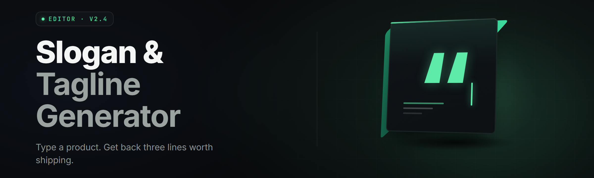

  
  
  

  

  
  
  

---

**Type a brand, a mood, a product. Get 40 ranked slogans in under three seconds — no cloud, no API key, no subscription, no "credits left."**

An on-device LLM reasoner pairs with a hand-tuned slogan-scoring kernel and a curated corpus of tagline patterns curated from decades of ad copy. It runs on your machine, writes to your disk, never phones home.

---

## 🧭 Overview

| Category | Details |
| --- | --- |
| **Product** | AI slogan / tagline generator for Windows desktops |
| **Core engine** | Local LLM reasoner + slogan pattern kernel v4 |
| **Output** | Ranked shortlists, A/B variants, tone overlays, competitor diffs |
| **Distributed as** | Single self-contained `.exe` (portable, no install wizard) |
| **Model footprint** | ~1.2 GB working set, ~4.1 GB peak during large batches |
| **Inference** | GPU (CUDA / DirectML) with CPU fallback |
| **Network** | Fully offline. No telemetry. No account. |

AI Slogan Forge was built for founders, copywriters, brand strategists, and weekend indie hackers who need slogan volume *now* without a SaaS tab open. It generates candidate lines, scores them on rhythm, memorability, and fit, then lets you steer with a plain-language brief. Everything lives in a `.slogan` project file you can version, diff, and share.

---

## 🩹 The Problem

- **SaaS payout fatigue.** Cloud slogan tools meter you per credit, throttle retries, and rotate their own model under you mid-project.
- **Generic mush.** Most AI taglines collapse into "Unlock the power of …" or "Your X, reimagined." Nothing survives a client read-back.
- **No scoring spine.** Tools hand you lines with zero signal about *why* one reads stronger than another.
- **Brand voice drift.** You paste the same brief and get a different tone every session because the model isn't held to a config.
- **Offline / NDA walls.** Agencies under contract can't upload client names and positioning to a stranger's endpoint.
- **Version churn.** Iterating means emailing yourself drafts. There's no project file, no diff, no rollback.
- **No competitor lens.** You can't see how your line stacks against a rival's tagline without building a spreadsheet by hand.

---

## 🧠 What is AI Slogan Forge? — glossary

| Term | Explanation |
| --- | --- |
| **Brief** | Your plain-language steering input: brand, product, audience, tone, taboo words, desired length. |
| **Reasoner** | The on-device LLM that drafts candidate slogans from a brief plus corpus signals. |
| **Pattern Kernel** | Rules + weights that recognize known tagline shapes (imperative, alliterative, compound, declarative). |
| **Score Stack** | Four sub-scores — Rhythm, Recall, Fit, Differentiation — combined into a single Force ranking. |
| **Dialect** | A preset voice pack (Terse Startup, Heritage Craft, Bold Retail, Clinical B2B, Poetic). |
| **Force Score** | 0–100 composite ranking shown next to every line. Higher = stronger shortlist candidate. |
| **Project File** | `.slogan` container holding briefs, generations, scoring history, and A/B branches. |

**Why people keep it open all day:**

1. Runs fully offline — client names never leave the machine.
2. Scores every line so shortlisting is a sort, not a vibe.
3. Dialects keep brand voice locked across sessions.
4. Project files diff and rollback like code.
5. GPU batch mode drafts 200 candidates in one pass.
6. No subscription, no credit meter, no login wall.

---

## 🧩 Grouped Module Catalog

**1. Brief Intake & Steering**

- **Brief Composer** — a single structured form: brand, product, audience, tone sliders, taboo list, max length, language register.
- **Steering Phrases** — inject up to 6 "must echo" tokens ("quiet", "overnight", "sharper") that bias generation without quoting.
- **Taboo Guard** — blocks banned words, clichés from your own list, and terms in a synced blocklist file.

**2. Generation Engine**

- **Reasoner Mode** — local LLM drafts from brief plus corpus priors.
- **Sprint Mode** — high-temp, high-volume, cheap candidates for widescreen brainstorming.
- **Polish Mode** — low-temp refinement of a line you've already picked.
- **Compound Expansion** — splits two-concept briefs (e.g. "fast + careful") into paired slogan skeletons.
- **Language Switch** — drafts in English, Spanish, Japanese, German, Portuguese, French.

**3. Scoring & Ranking**

- **Rhythm Scorer** — syllable stress and clause cadence.
- **Recall Scorer** — bigram novelty + phoneme repeat detection.
- **Fit Scorer** — alignment to brief tokens and tone dials.
- **Differentiation Scorer** — distance from a bundled corpus of 12,000 well-known taglines.
- **Force Composite** — weighted merge of the four, user-tunable via a weighting panel.

**4. Workspace & Comparative Views**

- **Shortlist Board** — drag lines into Tier 1/2/3 columns.
- **A/B Branches** — clone a brief, tweak one dial, diff the outputs side by side.
- **Competitor Diff** — paste a rival's tagline; see which of your candidates sit closest and furthest.
- **Tag Filtering** — tag lines (punchy, warm, tech, heritage) and filter instantly.

**5. Export, Protection & Ops**

- **Clipboard & Batch Export** — CSV, Markdown, plain text, or clipboard shelf.
- **Project File v2** — `.slogan` container with history and branches.
- **NLE Bridge** — export a slideshow-ready card set for pitch decks.
- **GPU Batch Scheduler** — queue multiple briefs during the day, run them overnight.

| Module | Status | Description |
| --- | --- | --- |
| Brief Composer | ✅ Working | Structured intake with tone sliders and taboo guard |
| Steering Phrases | ✅ Working | Up to 6 must-echo tokens to bias generation |
| Reasoner Mode | ✅ Working | Main local LLM drafting pipeline |
| Sprint Mode | ✅ Working | High-temp brainstorm pass |
| Polish Mode | ✅ Working | Low-temp refinement on a picked line |
| Force Composite | ✅ Working | Weighted four-score merge, user-tunable |
| Shortlist Board | ✅ Working | Tiered drag-and-drop with tag filters |
| A/B Branches | ✅ Working | Diff two brief-tweaks in one view |
| Competitor Diff | ✅ Working | Distance view vs pasted rival taglines |
| `.slogan` Project File v2 | ✅ Working | Versioned container with history rollback |
| GPU Batch Scheduler | ✅ Working | Queued overnight bulk runs |
| NLE Bridge | 🧪 Beta | Deck-ready card export for pitch tools |
| Japanese Language Dialect | 🧪 Beta | Refined tokenizer pass in progress |

## 

  

---

## 🎨 Key Features — Feature | Description | Benefit

| Feature | Description | Benefit |
| --- | --- | --- |
| Offline Reasoner | Local LLM, no network calls, no account | Client names stay on your disk |
| Force Score | Composite 0–100 ranking on every line | Shortlisting becomes a sort, not a vibe |
| Five Dialects | Preset voice packs (Terse Startup, Heritage Craft, Bold Retail, Clinical B2B, Poetic) | Brand voice stays consistent session to session |
| Steering Phrases | 6 must-echo tokens bias generation without literal quoting | You keep final control over key nouns |
| Taboo Guard | Blocks your blocklist across all modes | No accidental cliché leakage into shortlists |
| Competitor Diff | Distance view against pasted rival taglines | See how shielded your candidate is |
| A/B Branches | Duplicate a brief, tweak one dial, diff outputs | Iterations without emailing yourself drafts |
| `.slogan` v2 Project File | Versioned container with history and rollback | Every regeneration is reversible |
| GPU Batch Scheduler | Overnight bulk runs across queued briefs | Wake up to 400+ scored candidates |
| NLE Bridge (Beta) | Pitch-deck card export (PNG + copy) | Slide-ready output in one click |
| Sprint + Polish modes | Wide cheap brainstorms and tight refinement in one app | One tool covers exploration and finish |
| Language Switch | Draft in EN, ES, JA, DE, PT, FR | Ship multilingual decks without a second tool |

---

## 🧪 Module Status Detail

**Category: Intake**
- **Brief Composer** — form view with autosave; every keystroke persists into the current `.slogan` project.
- **Steering Phrases** — capped at 6 by design; more dilutes bias.
- **Taboo Guard** — merges an internal cliché list with your own blocklist file.

**Category: Generation**
- **Reasoner Mode** — the default drafting pass; balanced temp and length control.
- **Sprint Mode** — 3–4× candidate volume per second, lower fit scores in exchange.
- **Polish Mode** — accepts a pasted line and returns refined siblings.
- **Compound Expansion** — detects two-concept briefs and ossifies skeleton structures.
- **Language Switch** — per-brief, per-generation; sets tokenizer dialect and example pool.

**Category: Ranking**
- **Rhythm Scorer** — syllable-stress model tuned on ~40k English ad lines.
- **Recall Scorer** — bigram novelty + phoneme repeat heuristic.
- **Fit Scorer** — weighted cosine against brief tokens + tone dial vector.
- **Differentiation Scorer** — min-distance to a bundled 12k known-tagline corpus.
- **Force Composite** — the four scores under one number; weighting panel exposed in Settings.

**Category: Workspace**
- **Shortlist Board** — three tiers, drag to move, color-coded force chips.
- **A/B Branches** — one brief → two variants → one split diff view.
- **Competitor Diff** — paste rival line(s), see ordered distance list.
- **Tag Filtering** — user-applied tags, persisted per project.

**Category: Export & Ops**
- **Clipboard Shelf** — reserve and stack lines for shift-paste workflows.
- **Batch Export** — CSV / MD / TXT with configurable columns.
- **Project File v2** — atomic writes, history ring buffer of last 200 edits.
- **NLE Bridge (Beta)** — PNG cards 1080×1350 with copy burned in.
- **GPU Batch Scheduler** — queue at will, run at temperature you preset.

---

## 🖥️ System Requirements

| Component | Minimum | Recommended |
| --- | --- | --- |
| OS | Windows 10 22H2 (64-bit) | Windows 11 24H2 |
| CPU | 4-core x86-64 | 8-core x86-64 with AVX2 |
| RAM | 8 GB | 16 GB |
| VRAM (GPU mode) | 6 GB (DirectML) | 8 GB+ CUDA-capable |
| Disk | 3.5 GB free | 8 GB free (SSD) |
| Display | 1366×768 | 1920×1080 |
| Runtime | VC++ Redist 2015–2022 | Same + latest GPU driver |

---

## 🧲 Installation

1. **Download** — grab the archive from the project landing page and extract it to a folder you own (e.g. `D:\Forge\`). Avoid `Program Files` unless you're signed in as administrator.
2. **First Run** — launch the `.exe`. On first launch it writes a `.slogan` workspace folder and unpacks the bundled model to `%LOCALAPPDATA%\AISloganForge\`.
3. **Quick Verify** — paste any brand name, leave every dial at default, press **Forge**. You should see 40 ranked lines within a few seconds and a filled Shortlist Board.

> GPU users: switch **Engine → GPU** in Settings. DirectML works on any recent GPU; CUDA requires an NVIDIA driver from 2024 or newer.

---

## ⚖️ Comparison — this tool vs the old way

| Aspect | Alternative | This Tool |
| --- | --- | --- |
| Cost model | SaaS credit meter, monthly tiers | One download, no meter |
| Offline capability | None — requires endpoint | Full offline draft + score |
| Ranking signal | None; lines handed over unordered | Force Score on every line |
| Voice consistency | Resets per session, drifts | Dialects lock tone across projects |
| Competitor lens | Manual spreadsheet | Built-in diff against pasted rivals |
| Project history | Email drafts, no diff | `.slogan` v2 with rollback |
| Bulk volume | Manual, one click at a time | Overnight GPU batch scheduler |
| Language coverage | One language per plan tier | Six dialects bundled |

---

## 🧷 Known Issues

| Issue | Fix |
| --- | --- |
| First launch briefly stalls (~10s) while unpacking the bundled model | Expected. Subsequent launches start in <2s. |
| DirectML GPU mode may pick the integrated GPU on hybrid laptops | Settings → Engine → pin the discrete adapter explicitly. |
| Japanese dialect scores lower on Rhythm Scorer in some builds | Known; Beta tokenizer pass in progress. Use Polish Mode as a workaround. |
| NLE Bridge exports black cards on some older Adobe installs | Update the target app, or export as PNG from the Batch Export panel instead. |
| Very long paste in Competitor Diff (>3,000 lines) slows scoring | Trim to the dominant 50–100 rival lines for a fast diff. |
| Antivirus flags the first write of the bundled model | Expected for a self-contained binary that writes to LocalAppData; whitelist the folder if you trust the build hash. |

---

## 🧮 The Solution — Problem mirror

| Problem | Solution |
| --- | --- |
| Credit meters | Fully offline; no meter, no login |
| Generic AI mush | Pattern Kernel + corpus priors push away from clichés |
| No ranking signal | Four-score Force Stack on every line |
| Brand voice drift | Dialects lock tone per project |
| NDA walls | Nothing leaves the machine |
| Version churn | `.slogan` v2 with history and rollback |
| No competitor lens | Built-in diff vs pasted rival lines |

---

## 📜 Slogan Pattern Kernel — Module | Status table

| Kernel Component | Status | Description |
| --- | --- | --- |
| Imperative Recognizer | ✅ Working | Detects "Do X. Get Y." shapes |
| Alliterative Filter | ✅ Working | Weights phoneme repeats |
| Compound Merger | ✅ Working | Splits and rejoins two-clause drafts |
| Declarative Trim | ✅ Working | Prunes subordinate clauses |
| Taboo Cliché Bundle | ✅ Working | 4,200-entry bundled cliché list |
| Recall Heuristics | ✅ Working | Bigram novelty scoring |

---

## 🔍 Table of Contents

- [Overview](#-overview)
- [The Problem](#-the-problem)
- [What is AI Slogan Forge? — glossary](#-what-is-ai-slogan-forge--glossary)
- [Grouped Module Catalog](#-grouped-module-catalog)
- [Key Features](#-key-features--feature--description--benefit)
- [Module Status Detail](#-module-status-detail)
- [System Requirements](#️-system-requirements)
- [Installation](#-installation)
- [Comparison](#️-comparison--this-tool-vs-the-old-way)
- [Known Issues](#-known-issues)
- [The Solution](#-the-solution--problem-mirror)
- [Slogan Pattern Kernel](#-slogan-pattern-kernel--module--status-table)
- [FAQ](#-faq)

---

## 🧯 FAQ

| Question | Answer |
| --- | --- |
| Does it require internet? | No. Everything runs on your machine. First launch unpacks the bundled model offline. |
| Can I use it on a machine with no GPU? | Yes. CPU fallback works; expect roughly 6–9s per 40-line batch on a modern 8-core. |
| Will it overwrite my old projects? | No. `.slogan` v2 files are versioned; older files are read but never overwritten. |
| Can I run it from a USB stick? | Yes. The `.exe` is portable; the workspace folder stays beside it if you launch from removable media. |
| Why does Force Score differ from my instinct? | The four sub-scores weight rhythm, recall, fit, and differentiation. Open Settings → Force Stack to retune the weights to your taste. |
| Can it write slogans in a language other than English? | Six dialects: English, Spanish, Japanese, German, Portuguese, French. Japanese is in Beta. |
| Is the model bundled or downloaded on first run? | Bundled in the archive — nothing is pulled from a remote server. |
| Will it run under a standard (non-admin) user? | Yes, as long as the extraction folder is one you own and `%LOCALAPPDATA%` is writable. |
| Do you support offline license keys? | The MIT-licensed build has no license gate. A paid team build adds a local signed key file for enterprise rollout. |
| Where do bug reports go? | The GitHub issue tracker on the project page. Include your Windows build and Force Stack weights. |

---

## 🧷 Changelog (last three)

- **v2.6.1** — DirectML adapter picker, NLE Bridge Beta card size presets, Faster Force Composite (~28% shorter pipeline).
- **v2.6.0** — GPU Batch Scheduler, Compound Expansion, Competitor Diff bulk paste.
- **v2.5.4** — Spanish and Portuguese dialects refined; Recall Scorer tuned against a new novelty corpus.

---

## 🛑 Safety / Legal

Distributed under MIT. Use it however you want. Don't paste client NDA material into transit tools — that's exactly why this one runs offline. No warranty, no guarantees about output quality, and no responsibility for a tagline that flops in a focus group.

## 

  

**AI Slogan Forge v2.6.1** is a small, opinionated desktop tool for a big opinionated job: give anyone 40 credible slogan candidates and enough ranking signal to pick the winner in one sitting. It runs quietly on your machine, remembers every version of every brief, and doesn't care whether you paste one brand or a hundred. Download it, brief it, forge.
